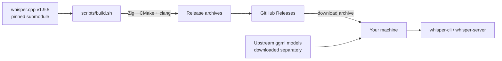

# whisper-native



Precompiled, CPU-only, cross-platform native binaries of
[whisper.cpp](https://github.com/ggml-org/whisper.cpp) — for Python
applications and standalone users who want local speech transcription
without Python ML dependencies, C++ toolchains, or GPU runtimes.

whisper-native does **not** fork or modify whisper.cpp. It builds the
upstream sources as-is (pinned git submodule) with a reproducible,
generic CPU baseline on every supported platform.

- **Project relation to upstream:** a thin, pinned packaging/build layer over
  upstream whisper.cpp. Upstream version: **v1.9.5**
  (commit `d1be6fde11ac6e0407606b4e42fe72d34add8037`).
- **License:** MIT (this project). Upstream whisper.cpp is also MIT; its
  license ships in every release archive as `LICENSE.whisper.cpp`.

## Supported platforms

| Operating system | Architecture | Build | Runs |
|---|---|---|---|
| Windows | x86_64 | Zig cross-compile (MinGW) | ✅ built & packaged |
| Windows | aarch64 | Zig cross-compile (MinGW) | ✅ built & packaged |
| macOS | x86_64 | native clang++ (`-arch x86_64`) | ✅ tested |
| macOS | aarch64 | native clang++ (`-arch arm64`) | ✅ built & packaged |
| Linux | x86_64 | Zig cross-compile (musl, static) | ✅ tested in CI |
| Linux | aarch64 | Zig cross-compile (musl, static) | ✅ built & packaged |

All builds are:

- **CPU-only** — no CUDA, ROCm/HIP, Vulkan, Metal, Core ML, or OpenCL.
  Generic binaries do not require, and will not load, any GPU runtime.
- **Statically self-contained** where the OS supports it (Linux musl
  static; Windows against system DLLs only; macOS against the system
  frameworks present on macOS 11+). No bundled runtime libraries.
- **Generic baselines** — `GGML_NATIVE=OFF` and every per-ISA option
  (`GGML_AVX2`, `GGML_FMA`, …) disabled; plain x86-64 / arm64 baseline
  code paths everywhere. No `-march=native`.

Not supported: 32-bit platforms, BSD, Android/iOS (out of scope), GPUs
(intentionally — no GPU-specific build variants in the release matrix).

## Downloading prebuilt binaries

Grab the archive for your platform from the GitHub Releases page, e.g.:

```
WhisperNative_v0.1.0_linux-x86_64.tar.gz
WhisperNative_v0.1.0_linux-arm64.tar.gz
WhisperNative_v0.1.0_macos-x86_64.tar.gz
WhisperNative_v0.1.0_macos-arm64.tar.gz
WhisperNative_v0.1.0_windows-x86_64.zip
WhisperNative_v0.1.0_windows-arm64.zip
```

Verify it against `checksums.txt` (published alongside the archives):

```bash
shasum -a 256 -c checksums.txt        # macOS / Linux
sha256sum -c checksums.txt            # Linux
certutil -hashfile WhisperNative_*.zip SHA256   # Windows
```

Each archive is flat and contains:

```
whisper-cli[.exe]            # the transcription CLI
whisper-server[.exe]         # the upstream HTTP server example
README.md                    # this document
LICENSE                      # MIT (this project)
LICENSE.whisper.cpp          # MIT (upstream whisper.cpp)
WHISPER-NATIVE-BUILDINFO.txt # versions, commit, platform, build date
```

Model weights are **not** included — download them separately (see below).

## Running whisper-cli

```bash
# Basic transcription (English-only model)
./whisper-cli -m ggml-tiny.en.bin -f audio.wav

# Same, with output file
./whisper-cli -m ggml-tiny.en.bin -f audio.wav -otxt

# Multilingual model with explicit language
./whisper-cli -m ggml-tiny.bin -f audio.wav -l de

# Help / version
./whisper-cli --help
./whisper-cli --version
```

`whisper-cli` accepts any compatible upstream ggml model file; language,
model size, and quantization are properties of the model file, not of the
build — there is one executable per platform, not per model.

Supported audio formats: wav, mp3, flac, ogg. For anything else (or to
resample), convert first with ffmpeg, e.g.
`ffmpeg -i input.mp4 -ar 16000 -ac 1 audio.wav`.

### English examples

```bash
# English-only tiny model on the bundled JFK sample
./whisper-cli -m ggml-tiny.en.bin -f samples/jfk.wav
# => "And so my fellow Americans ask not what your country can do for you..."

# Small English model, greedy, no timestamps
./whisper-cli -m ggml-small.en.bin -f meeting.wav -nt
```

### Multilingual examples

```bash
# Auto-detect language (works for every language whisper supports)
./whisper-cli -m ggml-base.bin -f interview.mp3

# Force a language (ISO code, e.g. fr, de, es, ja)
./whisper-cli -m ggml-base.bin -f interview.mp3 -l fr

# Translate any language to English
./whisper-cli -m ggml-base.bin -f interview.mp3 -l fr --translate
```

## Downloading and selecting models

Models are distributed as ggml files by upstream, hosted on Hugging Face
(`huggingface.co/ggerganov/whisper.cpp`). They are **not** part of the
executable releases; download them independently and keep them wherever
convenient.

The upstream helper (also vendored in the submodule at
`third_party/whisper.cpp/models/download-ggml-model.sh`) automates this:

```bash
# English-only models (smaller, faster, English only)
curl -L -o ggml-tiny.en.bin  https://huggingface.co/ggerganov/whisper.cpp/resolve/main/ggml-tiny.en.bin
curl -L -o ggml-base.en.bin  https://huggingface.co/ggerganov/whisper.cpp/resolve/main/ggml-base.en.bin
curl -L -o ggml-small.en.bin https://huggingface.co/ggerganov/whisper.cpp/resolve/main/ggml-small.en.bin
curl -L -o ggml-medium.en.bin https://huggingface.co/ggerganov/whisper.cpp/resolve/main/ggml-medium.en.bin

# Multilingual models (99 languages, optional translation)
curl -L -o ggml-tiny.bin     https://huggingface.co/ggerganov/whisper.cpp/resolve/main/ggml-tiny.bin
curl -L -o ggml-base.bin     https://huggingface.co/ggerganov/whisper.cpp/resolve/main/ggml-base.bin
curl -L -o ggml-small.bin    https://huggingface.co/ggerganov/whisper.cpp/resolve/main/ggml-small.bin
curl -L -o ggml-medium.bin   https://huggingface.co/ggerganov/whisper.cpp/resolve/main/ggml-medium.bin
curl -L -o ggml-large-v3.bin https://huggingface.co/ggerganov/whisper.cpp/resolve/main/ggml-large-v3.bin
```

Quantized variants (e.g. `ggml-base-q5_1.bin`, `ggml-small-q8_0.bin`) are
published upstream under the same path pattern
(`ggml-<name>-q<bits>_<type>.bin`); the executable loads them exactly like
any other ggml model — no special build or flags are needed.

Rule of thumb: `tiny`/`base` for fast drafts, `small`/`medium` for quality,
`large-v3` for best accuracy. `.en` models are distilled for English and
typically beat the same-size multilingual model on English audio. The
rough file sizes: tiny ≈ 75 MB, base ≈ 142 MB, small ≈ 466 MB,
medium ≈ 1.5 GB, large-v3 ≈ 3 GB.

The release build is self-tested against `ggml-tiny.en.bin` (English) and
`ggml-tiny.bin` (multilingual) — see `scripts/test_models.sh`.

## Building from source

Prerequisites:

- **macOS:** CMake ≥ 3.14, `clang`/`clang++` (Xcode CLT), Bash, and
  [Zig](https://ziglang.org) ≥ 0.14 for the non-macOS targets
- **Linux:** CMake, Zig, git, and Bash (the Zig toolchains supply the
  cross C/C++ compilers; no system gcc/clang required)
- **Windows:** via the Zig toolchains (e.g. from Linux/macOS) or a MinGW
  shell with CMake and Zig on PATH

```bash
git clone https://github.com/fordaj/whisper-native.git
cd whisper-native
git submodule update --init third_party/whisper.cpp

# Release build of all six targets into build/release/<platform>/
scripts/build.sh

# Debug build
BUILD_MODE=debug scripts/build.sh

# A subset of targets
TARGETS="linux-x86_64 macos-arm64" scripts/build.sh
```

Outputs land in `build/<mode>/<platform>/` as flat executables
(`whisper-cli`, `whisper-server`, with `.exe` on Windows).

### Smoke-testing models

```bash
scripts/test_models.sh   # downloads tiny.en + tiny once into build/models/,
                          # transcribes samples/jfk.wav, checks the result
```

### Release archives

```bash
scripts/release.sh --dry-run       # build + pack only, nothing remote
scripts/release.sh v0.1.0          # tag v0.1.0, build, pack, tag+release
scripts/release.sh --from-tag      # HEAD already on the release tag (CI)
```

`release.sh` verifies the upstream pin, cross-compiles, stages `dist/`,
writes `WHISPER-NATIVE-BUILDINFO.txt` into each archive, packs
`WhisperNative_<tag>_<platform>.tar.gz` (`.zip` on Windows), generates
`checksums.txt`, and creates the GitHub release (unless `--dry-run`).

## Configuring optional acceleration backends

The release matrix is deliberately CPU-only. For local experimentation you
can rebuild upstream whisper.cpp with any backend it supports by passing
extra CMake arguments — e.g. set `GGML_*`/`WHISPER_*` options via a small
wrapper around `scripts/build.sh`, or run CMake yourself:

```bash
cmake -S third_party/whisper.cpp -B build/metal-test \
  -DCMAKE_BUILD_TYPE=Release \
  -DWHISPER_BUILD_EXAMPLES=ON -DWHISPER_BUILD_SERVER=ON \
  -DGGML_METAL=ON -DGGML_NATIVE=ON          # <- your hardware chooses flags
cmake --build build/metal-test --parallel
```

Notes:

- `GGML_NATIVE=OFF` in the release build is what keeps artifacts generic;
  set it `ON` only for machines you compile on and run on.
- GPU backends require their SDKs/runtimes locally (CUDA toolkit, ROCm,
  Vulkan SDK, Metal via Xcode on macOS, OpenCL ICD). They produce binaries
  that only run where that runtime exists — not suitable for generic
  distribution, and intentionally excluded from releases.
- `-DGGML_NATIVE=OFF` with individual `-DGGML_AVX2=ON` / `-DGGML_FMA=ON`
  / `-DGGML_F16C=ON` flags is a reasonable middle ground for x86-64
  fleets without `-march=native`.
- Upstream options reference: `cmake -S third_party/whisper.cpp
  -B /tmp/cfg -LH | sort` lists every option with its default.

## Updating the upstream whisper.cpp version

1. Check out the new upstream tag inside the submodule:
   ```bash
   git -C third_party/whisper.cpp fetch --tags
   git -C third_party/whisper.cpp checkout v1.9.6   # or any newer tag
   ```
2. Update `WHISPER_CPP_VERSION` and `WHISPER_CPP_COMMIT` in
   `scripts/.common.env` to the new tag and its commit
   (`git -C third_party/whisper.cpp rev-parse HEAD`).
3. Commit the submodule bump and the `scripts/.common.env` change together.
   `scripts/build.sh` and `scripts/release.sh` verify that the submodule
   HEAD matches the pin and fail loudly otherwise.
4. Re-run `scripts/build.sh` and `scripts/test_models.sh`, inspect the
   produced `WHISPER-NATIVE-BUILDINFO.txt` in the archives, and check
   upstream's `WHISPER_VERSION_*` in their `CMakeLists.txt` matches the tag.

The build is reusable for future upstream executables: add the upstream
CMake target name to `WHISPER_EXECUTABLES` in `scripts/.common.env` and
rebuild — archives, metadata and CI pick it up automatically.
`whisper-server` (included since the initial release) is built exactly
this way.

## Continuous integration & releases

`.github/workflows/ci.yml` runs entirely on the org's self-hosted
runners (registered to this repo via `.runner-spawner.json`; see
`tools/runner-spawner`): the x86_64 macOS runner builds the macOS
x86_64 target natively plus all four Zig cross targets, and the x86_64
Windows runner rebuilds and smoke-tests the Windows targets natively.
The macOS leg also smoke-tests the native binary, runs the model tests
(`ggml-tiny.en` and `ggml-tiny` against `samples/jfk.wav`), and hosts
the release job. Pushing a `vX.Y.Z` tag rebuilds all six targets and
creates a GitHub release with the archives and `checksums.txt` (via
`scripts/release.sh --from-tag`).

### Self-hosted runners

CI uses the org's self-hosted runner pool (same setup as
`fordaj/logamuffin`), registered to this repository via
`.runner-spawner.json` (`.runners/` is git-ignored). The bundled
runner-spawner lifecycle manager lives in `tools/runner-spawner/`
(pinned v0.0.1.2.6):

```bash
source scripts/env.sh
"$RUNNER_SPAWNER_BIN" create                 # register + install runner01/runner02
"$RUNNER_SPAWNER_BIN" status                 # health + labels
"$RUNNER_SPAWNER_BIN" create --dry-run       # preview without touching the network
```

Labels are auto-assigned (`self-hosted,<os>,<arch>,…`), matching the
`runs-on: [self-hosted, macOS]` / `[self-hosted, Windows]` entries in
the workflow.

## License and attribution

- **whisper-native** (this project): MIT — see [LICENSE](LICENSE).
- **whisper.cpp** (upstream, `ggml-org/whisper.cpp`): MIT —
  see [third_party/whisper.cpp](third_party/whisper.cpp); the license ships
  in every release archive as `LICENSE.whisper.cpp`.
- **ggml** (bundled inside upstream whisper.cpp): MIT, same upstream repo.
- **Model weights** are distributed by upstream on Hugging Face under their
  own terms; they are not part of this project or its releases.
- Building, linking, and redistributing: whisper.cpp's MIT license permits
  this; please preserve the `LICENSE.whisper.cpp` file in redistributions.
