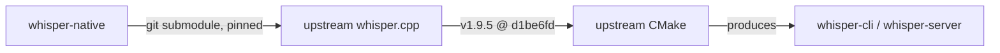

# Third-party dependencies

## whisper.cpp

- Location: `third_party/whisper.cpp` (git submodule)
- Upstream: <https://github.com/ggml-org/whisper.cpp>
- Pinned to: **v1.9.5** (commit `d1be6fde11ac6e0407606b4e42fe72d34add8037`)
- License: MIT (see `third_party/whisper.cpp/LICENSE`; shipped in every
  release archive as `LICENSE.whisper.cpp`)

The pin is the single source of truth, recorded in three places that are
kept in sync:

1. The submodule gitlink (`git ls-tree HEAD third_party/whisper.cpp`).
2. `WHISPER_CPP_VERSION` / `WHISPER_CPP_COMMIT` in `scripts/.common.env`.
3. `WHISPER-NATIVE-BUILDINFO.txt` inside every release archive.

`scripts/build.sh` and `scripts/release.sh` fail early when the checked-out
submodule does not match the pin.

To update the upstream version, see "Updating the upstream whisper.cpp
version" in the top-level [README](../README.md).
